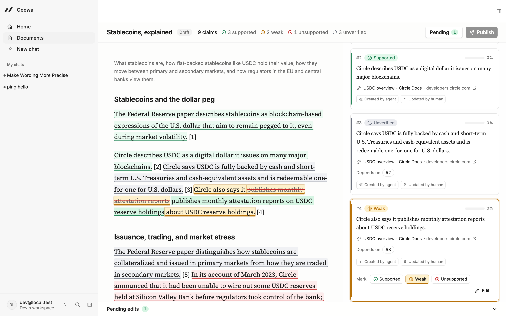
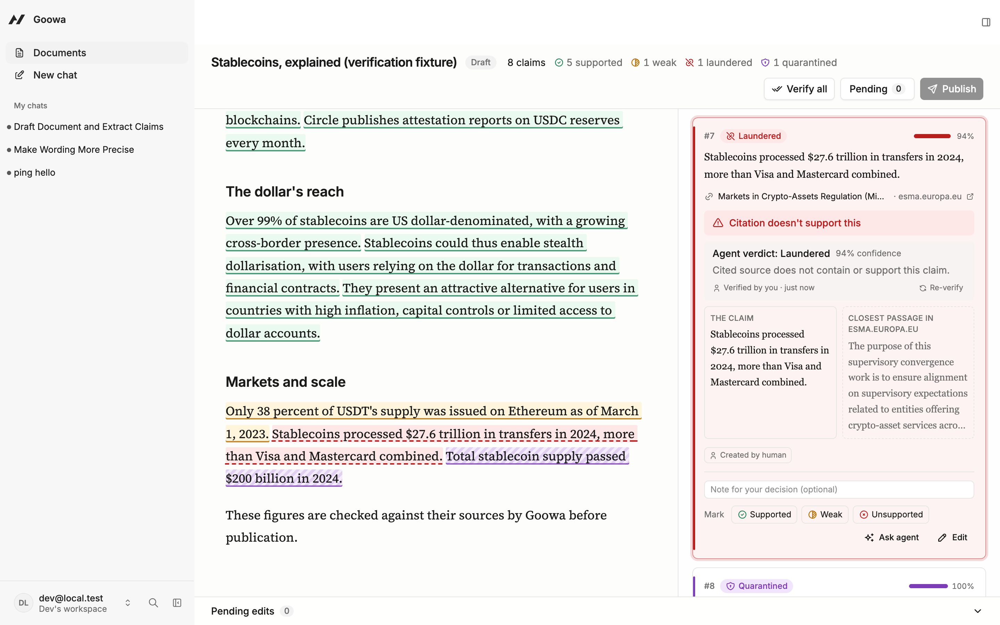
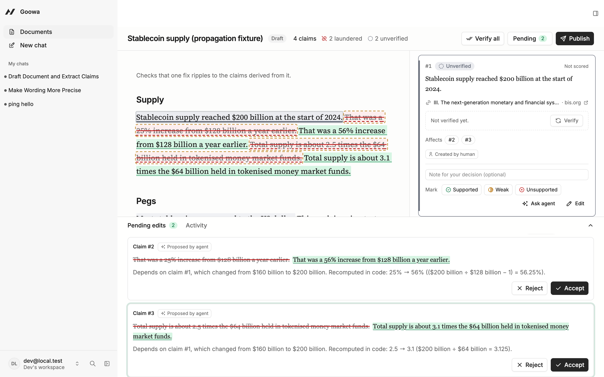

# Goowa

A research editor where an AI agent drafts a document and every factual claim
becomes an editable claim card, verified against its source. Humans correct
claims, the agent proposes edits, and only a human can publish.

Built on [Agent-Native](https://www.agent-native.com/docs/) for the Builder.io
Agent-Native Hackathon.

**Status: Phase 4** — dependency propagation and the publish gate. See [NOTES.md](NOTES.md).



## What's here

- `actions/ping.ts` — echoes text; reports whether the UI or the agent called it.
- `actions/fetch-source.ts` — fetches a URL server-side, returns title, a
  2,000-char readable excerpt, a sha256 of the readable text, or a typed error.
- `/spike` — page that calls both actions from the UI.
- Documents, sources, claims, and edits with the human-only rules
  (see AGENTS.md for the action list).
- `/docs/:id` — the editor: colour-coded claim highlights, claim cards,
  select-to-correct (flag or ask the agent), tracked-change proposals, and a
  pending edits drawer where only a human can accept.
- `/debug/:id` — the Phase 1 debug view (hidden from the nav).

## Verification

Each claim is checked against the full text of its cited sources. Exact
matches, laundered citations (the source loads but never says it), and changed
numbers are decided by rules; only paraphrases go to a model, which can only
choose among real sentences from the source. Prompt-injected pages are
quarantined on ingest.

```bash
AGENT_ORG_ID=<workspace id> pnpm verify:fixture   # PASS/FAIL per seeded claim
```



## Propagation and publishing

Fix one claim and everything that depends on it is flagged, re-verified, and
given code-computed rewrites in one change set. Publishing is human only and
passes a gate (unsupported, laundered, quarantined, needs-review claims,
pending proposals); a human can override some blockers with a reason.

```bash
AGENT_ORG_ID=<workspace id> pnpm demo:propagation
AGENT_ORG_ID=<workspace id> pnpm demo:gate
```



## Demo fixture

Runs create → ingest → draft → extract for a stablecoin explainer and checks
the result (needs a model provider connected in Settings › Model):

```bash
AGENT_ORG_ID=<workspace id> pnpm demo
```

The agent chat (`/chat`) calls the same two actions as tools.

## Run locally

Requires Node 22.22+ and pnpm.

```bash
pnpm install
cp .env.example .env   # add a provider key, e.g. ANTHROPIC_API_KEY
pnpm dev
```

Try it from the terminal:

```bash
pnpm action ping --text hello
pnpm action fetch-source --url https://en.wikipedia.org/wiki/Fact-checking
```

Actions on a document from the terminal run as you only when they know your
identity and workspace (otherwise ownership checks refuse them):

```bash
AGENT_USER_EMAIL=dev@local.test AGENT_ORG_ID=<workspace id> pnpm action get-document-state --documentId <id>
```

Run the tests:

```bash
pnpm test
```

## Choosing the model

Set `AGENT_ENGINE` and `AGENT_MODEL` in `.env` (see `.env.example`). Supported
engines: `anthropic`, `ai-sdk:openai`, `ai-sdk:anthropic`, `ai-sdk:google`,
`ai-sdk:groq`, `ai-sdk:mistral`, `ai-sdk:cohere`, `ai-sdk:openrouter`,
`ai-sdk:ollama`, `builder`. A default set in Settings › Model takes precedence.

## Deploy

Live: https://goowa.vercel.app (Vercel + Neon Postgres). Follows the
[Vercel guide](https://www.agent-native.com/docs/vercel/):

```bash
pnpm migrate:production          # with DATABASE_URL exported
NITRO_PRESET=vercel pnpm build
npx vercel deploy --prebuilt --prod
```

Production env: `DATABASE_URL` (from the Neon integration), `BETTER_AUTH_SECRET`,
`CRON_SECRET`, `AGENT_ENGINE`, `AGENT_NATIVE_VERCEL_CRON_SCHEDULE` (daily on
Hobby), and optionally `ACCESS_TOKEN` for MCP clients. Connect Builder.io (or
add a key) in Settings › Model on the deployed app.
