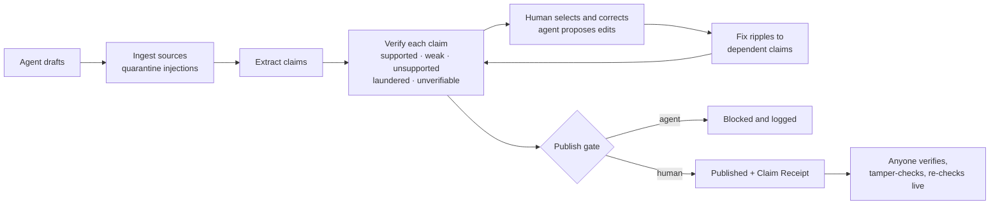
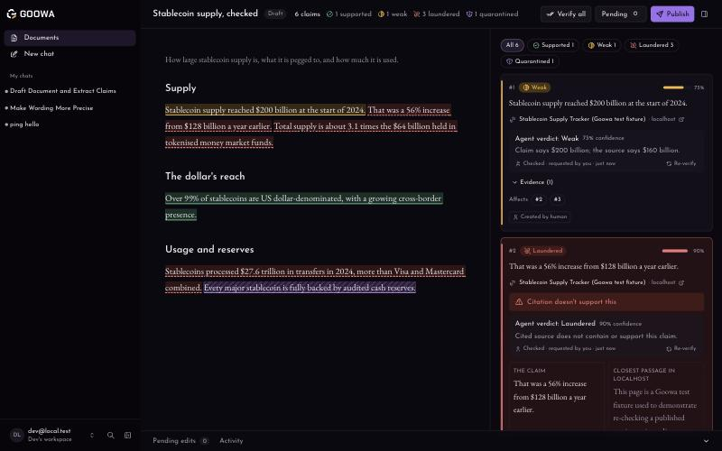

<p></p>

# Goowa

**AI drafts the research. You approve every claim.**

Goowa is a research editor built on [Agent-Native](https://www.agent-native.com).
An agent drafts a document; every factual sentence becomes a claim tied to the
passage that supports it; a human corrects, accepts, and publishes; and
publishing produces a tamper-evident Claim Receipt anyone can check.

Live: https://goowa.vercel.app · Demo video: _coming soon_

## The problem

AI writes fluent research with confident citations, and some of those
citations never said it. Checking means opening every source and hunting for
the sentence, so nobody does, and "laundered" citations (a real, reputable
URL attached to a claim it does not support) slip into reports, posts, and
pitch decks. Agents make this worse at scale. Goowa makes the check the
default: each claim carries its evidence, wrong figures ripple to everything
derived from them, an agent can never publish, and the published article
ships with proof.

## The loop





## How it uses Agent-Native

Every operation is a `defineAction` in [`actions/`](actions). The same action
serves the UI (client hooks), Goowa's in-app agent (as a tool), external
agents (over MCP at `/mcp`), and scripts (the CLI). Human-only rules are
enforced inside the actions from `ctx.caller`, not in prompts.

| Action | UI | In-app agent | MCP | Notes |
| --- | :-: | :-: | :-: | --- |
| `create-document`, `list-documents`, `get-document-state` | ✓ | ✓ | ✓ | |
| `ingest-sources`, `fetch-source`, `get-source-text`, `scan-source-for-injection` | ✓ | ✓ | ✓ | Pages with prompt injections are quarantined |
| `draft-document`, `extract-claims`, `add-claim` | ✓ | ✓ | ✓ | Claims are exact quotes; the server finds spans |
| `verify-claim`, `verify-document` | ✓ | ✓ | ✓ | Deterministic checks first, model only picks among real sentences |
| `update-claim`, `propagate-change` | ✓ | ✓ | ✓ | Agents' text changes become proposals |
| `propose-edit` | ✓ | ✓ | ✓ | Select-to-correct answers with this |
| `request-publish` | ✓ | ✓ | ✓ | Runs the publish gate |
| `check-draft` | | ✓ | ✓ | For external agents: check outside text |
| `get-receipt`, `verify-receipt`, `recheck-receipt-live` | ✓ | ✓ | ✓ | Public, read-only |
| `decide-edit`, `publish` | ✓ | | refuses | **Human only.** Agent attempts are logged |
| `mark-reviewed`, `set-document-status`, `set-live-fixture-version`, `reset-demo` | ✓ | | | **Human only** |

Framework pieces used: `defineAction` and action errors, `useActionQuery` /
`useActionMutation`, live sync (`useDbSync`), progress runs, sharing and
access control (`ownableColumns`, `assertAccess`), `decide()` for the only
model call, `ssrfSafeFetch`, the agent chat and its MCP server, settings
storage, and the auth plugin's public paths for receipts.

## Permission model

- **The agent proposes; a human decides.** Agents (in-app or over MCP) can
  draft, ingest, extract, verify, and propose edits. Only a human can accept or
  reject an edit, set a final claim status, clear a review flag, override a
  blocker (with a reason), or publish.
- **Enforced on the server.** `ctx.caller` `frontend` or `cli` is human;
  everything else, including MCP, is the agent. `publish` and `decide-edit`
  are listed for MCP so an attempt can be refused and logged ("Agent attempted
  to publish · blocked"), and counted on the receipt.
- **Personal, revocable MCP access.** Tokens come from `/mcp/connect` and stop
  working the moment they are revoked under "Existing connections".
- **Quarantine is not overridable.** A claim backed only by a source with a
  prompt injection cannot be published until the human re-sources it.

## Claim Receipt

Publishing freezes a receipt: the body, every claim with its verdict,
evidence spans, source content hashes, human decisions and override reasons,
and a canonical SHA-256 hash over all of it. The public page at `/r/<id>`
verifies the hashes in the browser, pinpoints a single edited character, and
re-checks the sources live. Spec: [docs/receipt-spec.md](docs/receipt-spec.md).

## Use Goowa from Claude or Cursor

Goowa is an MCP server at `https://goowa.vercel.app/mcp`. Create a personal
token at **/mcp/connect** (revoke it there any time).

**Cursor** (`~/.cursor/mcp.json`):

```json
{
  "mcpServers": {
    "goowa": {
      "url": "https://goowa.vercel.app/mcp",
      "headers": { "Authorization": "Bearer <your Goowa token>" }
    }
  }
}
```

**Claude Desktop / claude.ai**: Customize → Connectors → Add custom connector →
`https://goowa.vercel.app/mcp`, then approve.

**Claude Code**:

```bash
claude mcp add --transport http goowa https://goowa.vercel.app/mcp
```

Then: *"Use Goowa's check-draft on this paragraph with these sources …"*. Pass
`claims` (exact quotes) for precise extraction; otherwise every sentence with a
figure, date, or name is checked.

## Run locally

Requires Node 22.22+ and pnpm.

```bash
pnpm install
cp .env.example .env   # add a model provider key, e.g. ANTHROPIC_API_KEY
pnpm dev               # http://localhost:8080
```

Demo and checks (with the dev server running):

```bash
pnpm demo:reset                      # fresh demo document in <1s; or open /demo
pnpm demo:full                       # whole flow 3×, timings, identical verdicts
AGENT_ORG_ID=<workspace id> pnpm verify:fixture   # one claim per verdict
pnpm test
```

## Deploy

Live on Vercel with Neon Postgres. Pushes to `main` build automatically
(`vercel.json`). Run migrations before pushing a schema change:

```bash
pnpm migrate:production   # with the production DATABASE_URL exported
```

Production env: `DATABASE_URL` (Neon integration), `BETTER_AUTH_SECRET`,
`CRON_SECRET`, `AGENT_ENGINE`. Connect a model provider in Settings › Model on
the deployed app. On production, open `/demo` (signed in) to reset the demo
document.

Built for the Builder.io Agent-Native Hackathon, 2026. See
[SUBMISSION.md](SUBMISSION.md).
